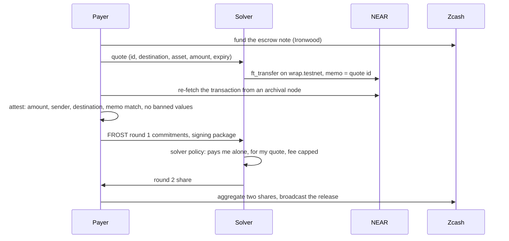
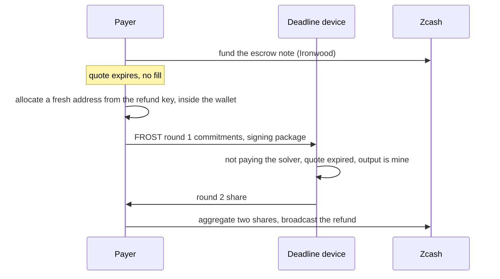

<div align="center">

<h1>ironwood-intent-escrow</h1>

<p><strong>A 2-of-3 FROST escrow on Zcash's Ironwood shielded pool.</strong><br>
Fills on another chain. Refunds to a fresh shielded address.<br>
Never writes a Zcash address, transaction id, or amount on the other chain.</p>

<p>
<a href="https://github.com/lancekrogers/ironwood-intent-escrow/actions/workflows/ci.yml"></a>
<a href="#license"></a>

</p>

</div>

A payer locks ZEC in a note that any two of three FROST shares can spend. A
solver fills the payer's quote on another chain and the note is released to
the solver. If the fill never happens, the note is refunded after expiry to
a fresh shielded address that the quote and the other chain never saw.

The receipt on the other chain carries only the quote id. It never carries a
Zcash address, a Zcash transaction id, or the zatoshi amount of the escrow
note. That is the whole point: today's cross-chain intent flows write a
`refundTo` shielded address onto the public chain the moment a deposit
registers, whether or not a refund ever happens
([Zakura, quantum unlinkability](https://zakura.com/engineering/quantum-unlinkability/)).
This design has no such field.

## Status

Proven on testnet, not on mainnet, and not audited.

- Both paths ran end to end on Zcash testnet and NEAR testnet on
  2026-10-22. Four Zcash transactions were mined through a public light
  server with no local node. The records are in [`runs/`](runs/).
- **The escrow key is a trusted-dealer test key, not distributed key
  generation.** ZIP 312 does not yet specify FROST key generation for
  Orchard-style keys (zcash/zips#895 is open), so `keygen` derives a normal
  spending key in memory, splits its spend authorizing key into three
  shares, and drops the original. See
  [`docs/decisions/stack.md`](docs/decisions/stack.md), section "Blocked".
- The key uses the legacy derivation (`use_qsk = false` in ZIP 2005), so the
  note is not quantum recoverable.
- **The expiry is signer policy, not consensus.** A shielded pool has no
  script and no timelock. The chain accepts an early refund if two shares
  sign it. The design relies on the third share living on the payer's own
  second device, which refuses to sign before expiry.

## How it works

### The three shares

Spend authority over the escrow note is a 2-of-3 threshold over the Orchard
spend authorizing key, signed with re-randomized FROST on RedPallas
(ZIP 312). No holder has the full key and no process ever assembles it.

| Share | Holder | Signs |
|---|---|---|
| `payer.key` | the payer | the release, after attesting the fill; the refund |
| `solver.key` | the solver | the release only, and only a release that pays the solver |
| `deadline.key` | the payer's second device | the refund only, after expiry |

The deadline holder is not an arbiter. It is the payer's own device, so the
solver never holds it and no third party can lock the payer out. Its only
job is to refuse to pay the solver.

### Fill



The deadline device is handed the same package and returns
`refused_release`. Its share is never collected for a fill.

### Refund



The solver's share is not used. The refund output is encrypted to the
payer's refund outgoing viewing key, which the solver does not hold.

### Two signing rounds

FROST is interactive. Each signer runs round 1 with its share and publishes
commitments. The coordinator, which is the payer process in both runs,
builds a signing package from the checker view of the PCZT: the sighash,
the escrow spend's own randomizer `alpha`, the commitments, and a hash of
the PCZT. Every signer verifies the package against the PCZT it holds and
applies its policy before any round 2 share exists. The coordinator
aggregates two shares, verifies the signature against the randomized
verifying key, and applies it to the PCZT.

## The eight product rules

Each rule is enforced in code and was checked against the recorded runs.

1. The note is an Ironwood note, and neither funding nor spending produces
   a transparent output. `check_zec` in `src/checker.rs`.
2. Both Zcash transactions use a real outgoing viewing key; an all-zero key
   fails the checker. `check_zec`, by trial decryption.
3. 2-of-3 re-randomized FROST: no holder spends alone and the key is never
   reconstructed. `src/frost.rs`, with `one_share_does_not_verify` and
   `keygen_no_combined_key` as tests.
4. The quote carries id, destination, asset, amount, and expiry, and no
   refund address. `src/quote.rs` rejects a `refund_to` field.
5. The refund address is created when the refund is built, inside the
   payer's wallet. `build_refund` in `src/policy.rs`.
6. The payer checks the other chain's payment of the quote id, fetched from
   a node the payer chooses. `attest` in `src/attest.rs`.
7. The checker rejects a receipt that contains a Zcash address, a Zcash
   transaction id, or the zatoshi amount, searching decoded call args and
   logs. `check_payload` in `src/attest.rs`.
8. The checker rejects a transparent output or a zero outgoing viewing key
   on either Zcash transaction. `check_zec`, with negative fixtures.

## Testnet evidence

From [`runs/fill.json`](runs/fill.json) and
[`runs/refund.json`](runs/refund.json). Raw transaction bytes are beside
them as `.tx` files, and the fetched NEAR payload is `fill.near.json`.
Transaction ids are shortened here; the full values are in the records.

| Run | Step | Transaction | Mined at |
|---|---|---|---|
| Fill | fund escrow | `20058089…e03b0512` | 4,530,559 |
| Fill | release to solver | `f094fdf4…9c6df61b` | 4,530,577 |
| Refund | fund escrow | `46ebf892…66104b08` | 4,530,586 |
| Refund | refund to fresh address | `7fcc618a…c7344b4e` | 4,530,598 |

The fill's NEAR payment is
[`7J1bzUpXaJo2oHqtbXHh5sme7FXhucexpiQiQ7fkG7uk`](https://testnet.nearblocks.io/txns/7J1bzUpXaJo2oHqtbXHh5sme7FXhucexpiQiQ7fkG7uk)
from `ironwood-solver-a5slbw.testnet`, re-fetched from
`https://archival-rpc.testnet.near.org`. Its SHA-256 is recorded in
`fill.json` and a later re-fetch returned identical bytes.

Policy outcomes recorded in the runs: the deadline device refused the
release, still refused the fill's package during the refund run, and signed
the refund only after expiry. The refund address appears in neither quote,
in no fill record, and nowhere on NEAR.

Light server: `testnet.zec.rocks:443`. Zcash testnet is past both NU6.3
(Ironwood, height 4,134,000) and NU7 (4,465,026).

## Running it

### Prerequisites

- Rust 1.92 or newer. There are no parameter files to download: the Halo 2
  proving key is built in process from the `orchard` crate.
- Zcash testnet funds. `faucet.testnet.valargroup.dev` pays 0.125 TAZ a day
  to the address `payer_wallet` prints, with no browser or captcha. One
  payout covers both runs.
- Two NEAR testnet accounts and `near-cli-rs`. Create them with
  `near account create-account sponsor-by-faucet-service`: one solver that
  pays wNEAR and one payer that receives it. The solver wraps NEAR with
  `near_deposit` on `wrap.testnet`, and the payer registers once with
  `storage_deposit`.
- A `run.json` in `~/.ironwood-intent-escrow/testnet/` naming them:

  ```json
  {
    "solver_account": "<solver>.testnet",
    "solver_key_file": "/absolute/path/to/<solver>.testnet.json",
    "payer_account": "<payer>.testnet",
    "near_cli": "/absolute/path/to/near"
  }
  ```

Keys and wallets live outside every repository under
`~/.ironwood-intent-escrow/testnet/`, mode 0600. The repository tracks no
key, seed, or viewing key, and `.gitignore` refuses `*.key` and `*.fvk`.
The exact steps taken on 2026-10-22 are in
[`docs/decisions/stack.md`](docs/decisions/stack.md), section "Funding".

```text
cargo run --bin payer_wallet -- ~/.ironwood-intent-escrow/testnet/payer   # create the payer wallet, print the faucet address
cargo run --bin payer_wallet -- ~/.ironwood-intent-escrow/testnet/payer --scan   # scan and print the balance
cargo run --release --bin fill      # fund, pay on NEAR, attest, sign with payer + solver, broadcast
cargo run --release --bin refund    # fund, expire, sign with payer + deadline, broadcast
cargo run --bin near_tx -- <tx-hash> <sender-account>   # re-fetch a NEAR transaction and print its SHA-256
```

`fill` and `refund` save state before every broadcast or payment, so a
rerun resumes and never funds or pays twice.

Checks, which CI runs on every push:

```text
cargo test                                  # 84 tests, none ignored, no network; proving tests build the Halo 2 key once per process
cargo fmt --check
cargo clippy --all-targets -- -D warnings
```

## Crate stack

| Crate | Version | Role |
|---|---|---|
| `frost-core`, `frost-rerandomized` | 3.0.0 | key split, round 1, round 2, aggregate with a caller-supplied randomizer |
| `reddsa` (feature `frost`) | 0.5.2 | the RedPallas spend-auth FROST ciphersuite |
| `orchard` | 0.16.0 | keys, notes, the Halo 2 circuit |
| `zcash_primitives` | 0.31.0 | v6 transactions with Ironwood spends and outputs |
| `pczt` | 0.10.0 | ZIP 374 partially created transactions, proving and signature application |
| `zcash_client_backend` | 0.25.0 | Ironwood scanning, light-client gRPC over TLS |
| `zcash_client_sqlite` | 0.23.0 | the payer and solver wallet stores |
| `zcash_keys`, `zcash_address`, `zcash_protocol` | 0.17.0, 0.14.0, 0.11.0 | unified keys and addresses, network parameters |

`reddsa` 0.5.2 is the last release with the FROST ciphersuite, while
`orchard` 0.16.0 depends on `reddsa` 0.6, so two versions build side by
side and signatures cross the boundary as bytes. Full reasoning and the
measured facts behind each pin are in
[`docs/decisions/stack.md`](docs/decisions/stack.md).

## Repository layout

```text
src/            library: frost, cosign, policy, attest, checker, quote, wallet, light, run
src/bin/        payer_wallet, fill, refund, near_tx
tests/          integration tests; fixtures/ holds accepted and banned NEAR payloads
docs/decisions/ the decisions the code implements: shares, receipt chain, stack
runs/           the two recorded testnet runs: records, raw transactions, NEAR payload, quotes
```

The decision files are the implemented truth. Where they were wrong, they
say so and what was measured instead.

## What this repository does not hold

No token, no spending key, no full viewing key, and no solver inventory.

## License

Licensed under either of [Apache License, Version 2.0](LICENSE-APACHE) or
[MIT License](LICENSE-MIT) at your option.
