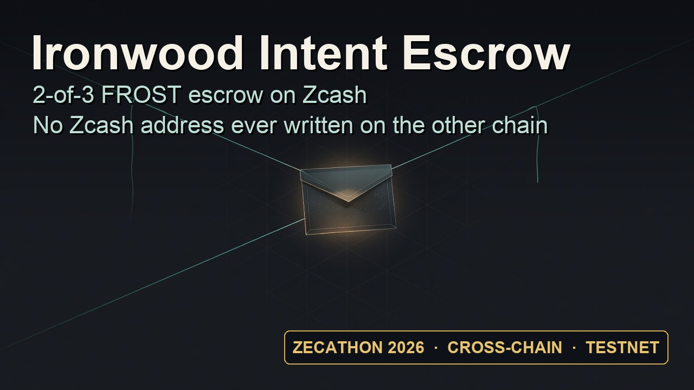
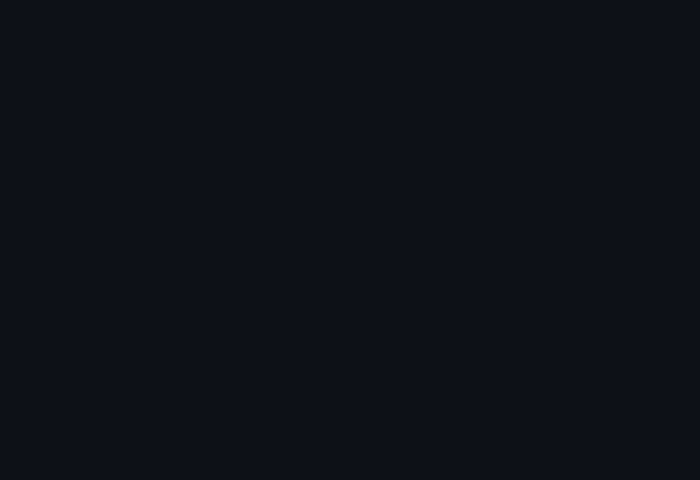

<div align="center">

<h1>ironwood-intent-escrow</h1>

<p><strong>A 2-of-3 FROST escrow on Zcash's Ironwood shielded pool.</strong><br>
Fills on another chain. Refunds to a fresh shielded address.<br>
Never writes a Zcash address, transaction id, or amount on the other chain.</p>

<p>
<a href="https://github.com/lancekrogers/ironwood-intent-escrow/actions/workflows/ci.yml"></a>
<a href="#license"></a>

<a href="https://github.com/Obedience-Corp/festival"></a>
</p>

</div>

A payer locks ZEC in a shielded escrow. A solver pays the quote on NEAR,
then the payer and solver co-sign the ZEC release. If no fill happens, the
payer and its deadline device can refund to a fresh shielded address after
expiry. That address never enters the quote or the NEAR transaction.

**Testnet only. Not audited. The payer controls two shares, so this does
not protect a solver against a dishonest payer.**

## Demo

[**Open the browser demo →**](https://lancekrogers.github.io/ironwood-intent-escrow/)
Click **Verify on testnet** to check the completed fill and refund against public
testnet data. No wallet, funds, sign-in, or installation needed. It runs the
shared Rust checks in WebAssembly; it does not create a new escrow.

<p align="center">
  <a href="https://youtu.be/LTd2J9bINGY"></a><br>
  <a href="https://youtu.be/LTd2J9bINGY">Watch on YouTube · 3:05</a>
</p>

The verifier runs live in the video; fill and refund show the recorded
testnet runs. [Download the video](demo/zecathon.mp4).

## Verify the recorded runs

Requires Rust 1.92 or newer. No keys, accounts, or funds needed.

```sh
git clone https://github.com/lancekrogers/ironwood-intent-escrow
cd ironwood-intent-escrow
cargo run --release --locked --bin verify
```

The verifier fetches four Zcash transactions and the NEAR payment from
public testnet nodes, compares them with the committed records, and checks
transaction privacy, the payment, and recorded policy outcomes. A passing
live run reports **18 passed, 0 failed, 0 skipped**. The first run compiles
the dependencies.

To check the stored evidence without fetching from the network:

```sh
cargo run --release --locked --bin verify -- --offline
```

[Run new fills and refunds](docs/technical-guide.md#prerequisites-for-running-the-flows)
with your own testnet wallets.

## How it works

The escrow uses 2-of-3 re-randomized FROST signatures over RedPallas.
After trusted-dealer setup, signing uses shares without reconstructing the key.

| Path | Who signs | What they check |
|---|---|---|
| Fill | Payer + solver | The NEAR payment matches the quote; the ZEC release pays the solver |
| Refund | Payer + deadline device | The quote expired, the output belongs to the payer, and no supplied fill claim attests |

The deadline device belongs to the payer and refuses releases to the solver.
Both refund signers re-fetch a claimed NEAR payment and refuse the refund
if it satisfies the quote.

The quote ID is the NEAR receipt's only explicit reference to the escrow.
The NEAR accounts and wNEAR amount are public; no Zcash address, transaction
ID, or amount is written there. The refund address is created inside the
payer's wallet when the refund is built.

[Protocol diagrams and signing details](docs/technical-guide.md#how-it-works)
· [Privacy rules](docs/technical-guide.md#the-eight-product-rules)

## Evidence and limits

Both paths ran on Zcash and NEAR testnet on October 22–23, 2026. The
[fill](runs/fill.json) and [refund](runs/refund.json) records include four
mined Zcash transactions, with raw bytes in [runs/](runs/). The
[NEAR payment](https://testnet.nearblocks.io/txns/7J1bzUpXaJo2oHqtbXHh5sme7FXhucexpiQiQ7fkG7uk)
paid 0.01 wNEAR. The refund run also demonstrated refusal to refund the
already-paid fill quote.

- The payer can bypass its deadline device's policy or withhold a fill
  claim. Expiry is enforced by the signer, not by an on-chain timelock.
- A trusted dealer creates the key. There is no distributed key generation,
  and the legacy key derivation is not quantum recoverable.
- Observers can correlate activity across chains by timing. The NEAR leg
  is public.

[Full threat model](docs/technical-guide.md#threat-model)
· [Testnet evidence](docs/technical-guide.md#testnet-evidence)
· [ZECATHON submission](docs/submission.md)

## Development

```sh
cargo test
cargo fmt --all --check
cargo clippy --all-targets -- -D warnings
```

CI runs these checks. The suite has 102 tests, with no network required.
See the [crate stack](docs/technical-guide.md#crate-stack) and
[design decisions](docs/decisions/) for implementation details.
`just demo` renders the video from its narration and terminal tapes.

## Built with Festival

Planned and executed with [Festival](https://github.com/Obedience-Corp/festival)
and its [fest CLI](https://github.com/Obedience-Corp/fest): design decisions,
implementation, tests, and review tracked in files and Git.

<details>
<summary>Watch the build and submission replays</summary>

<p align="center">
  <a href="docs/replays/ironwood-intent-escrow-II0001.gif"></a>
  <a href="docs/replays/zecathon-submission-ZS0001.gif"></a>
</p>

</details>

## License

[MIT](LICENSE-MIT) OR [Apache-2.0](LICENSE-APACHE), at your option.
